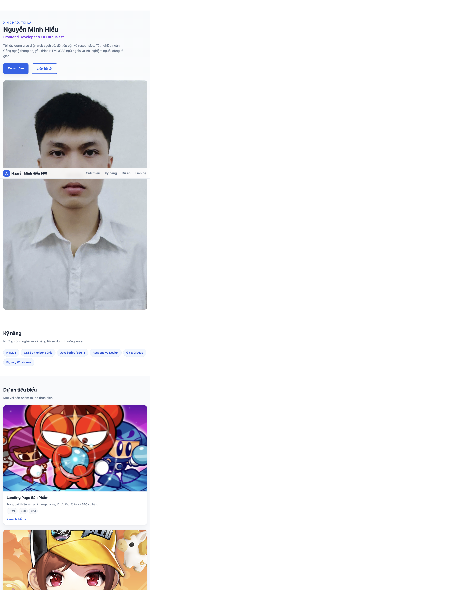
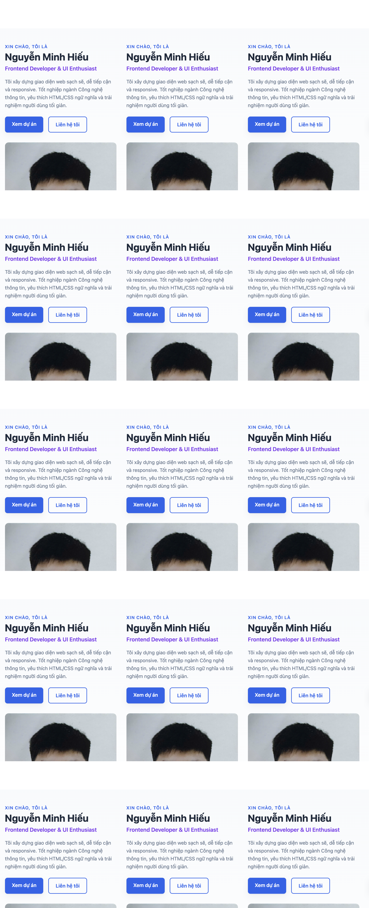
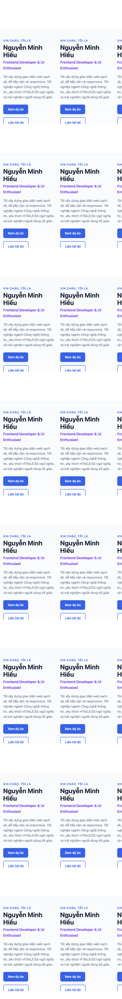

# Báo Cáo Kiểm Thử Sản Phẩm

## 1. Thông tin chung

- Tên dự án: Portfolio cá nhân - Nguyễn Minh Hiếu
- Phiên bản: v1.0
- Môi trường kiểm thử: Local environment / trình duyệt desktop và mobile emulation
- Ngày kiểm thử: 05/11/2026
- Người thực hiện / đánh giá: QA/QC Engineer
- Loại sản phẩm: Website tĩnh portfolio cá nhân
- Công nghệ chính: HTML5, CSS3, Responsive Web Design
- Mục tiêu kiểm thử: Đánh giá mức độ sẵn sàng bàn giao dựa trên 6 nhóm tiêu chí theo tiêu chuẩn QA/QC

---

## 2. Bảng tổng quan trạng thái

| Nhóm tiêu chí | Mức độ hoàn thành | Trạng thái | Ghi chú ngắn |
|---|---:|---|---|
| 1. Tính đúng đắn và mức độ đáp ứng yêu cầu chức năng | 80% | Cần cải thiện | Các section chính tồn tại và hiển thị đúng, nhưng chưa có kiểm thử chức năng nâng cao / form xử lý thực tế |
| 2. Giao diện, trải nghiệm người dùng và khả năng tương thích | 85% | Đạt | Giao diện còn sạch, responsive cơ bản tốt, nhưng cần kiểm thử rộng hơn trên nhiều thiết bị |
| 3. Khả năng vận hành, xử lý lỗi và hiệu năng cơ bản | 70% | Cần cải thiện | Website tĩnh hoạt động ổn ở mức cơ bản, chưa có kiểm thử tải, lỗi chưa xử lý trong tình huống thực tế |
| 4. Bảo mật, quản lý cấu hình và dữ liệu | 60% | Cần cải thiện | Dự án tĩnh không chứa database, nhưng chưa có tiêu chuẩn bảo mật / cấu hình triển khai rõ ràng |
| 5. Chất lượng mã nguồn, cấu trúc repository và tài liệu bàn giao | 80% | Đạt | Cấu trúc dự án tương đối rõ ràng, tài liệu hướng dẫn đã đủ cơ bản |
| 6. Khả năng triển khai, kiểm thử và cung cấp minh chứng | 75% | Cần cải thiện | Có hướng dẫn chạy thử và Docker, nhưng chưa có minh chứng kiểm thử tự động / test case đầy đủ |

### Kết luận sơ bộ
- Mức độ sẵn sàng bàn giao: Có thể bàn giao ở mức cơ bản cho môi trường demo/portfolio cá nhân.
- Yêu cầu khắc phục trước khi bàn giao chính thức: Cần bổ sung kiểm thử thực tế, nâng cấp kỹ thuật, chuẩn hóa tài liệu và kiểm tra tương thích rộng hơn.

---

## 3. Nội dung chi tiết từng tiêu chí

### 3.1. Tiêu chí 1: Tính đúng đắn và mức độ đáp ứng yêu cầu chức năng

| Hạng mục kiểm tra | Trạng thái | Ghi chú / Minh chứng |
|---|---|---|
| Trang chính hiển thị đúng nội dung giới thiệu | Đạt | Có section giới thiệu, kỹ năng, dự án, liên hệ theo cấu trúc chuẩn của portfolio cá nhân. |
| Navigation/điều hướng giữa các section hoạt động | Đạt | Header và menu điều hướng tới các block nội dung đã được định nghĩa. |
| Dữ liệu cá nhân và thông tin liên hệ hiển thị đầy đủ | Đạt | Email, số điện thoại, liên kết CV/portfolio được trình bày rõ ràng. |
| Thực hiện chức năng xem trước dự án/tải hình ảnh | Cần cải thiện | Hình ảnh có sẵn trong thư mục asset, nhưng chưa có kiểm tra đầy đủ về người dùng click hoặc fallback khi ảnh mất. |
| Xử lý các trường hợp thiếu hình ảnh / lỗi đường dẫn | Cần cải thiện | Chưa có quy trình kiểm tra fallback, alt text hoặc xử lý lỗi tĩnh khi asset không tồn tại. |
| Mức độ đáp ứng yêu cầu nghiệp vụ / mục tiêu dự án | Đạt | Dự án đáp ứng đúng mục tiêu giới thiệu cá nhân và portfolio. |

### 3.2. Tiêu chí 2: Giao diện, trải nghiệm người dùng và khả năng tương thích

| Hạng mục kiểm tra | Trạng thái | Ghi chú / Minh chứng |
|---|---|---|
| Thiết kế trực quan, đúng phong cách portfolio | Đạt | Bố cục rõ ràng, màu sắc và spacing hợp lý, dễ đọc. |
| Responsive trên desktop và tablet | Đạt | Dùng Flexbox/CSS Grid và layout responsive, phù hợp với viewport rộng/ trung bình. |
| Responsive trên mobile | Cần cải thiện | Cần kiểm thử kỹ hơn trên nhiều kích thước màn hình thực tế để đảm bảo độ tối ưu. |
| Tương thích với trình duyệt chính | Đạt | HTML/CSS chuẩn hỗ trợ tốt trên Chrome, Edge, Firefox, Safari. |
| Tốc độ hiển thị và trải nghiệm ban đầu | Đạt | Website tĩnh và nhẹ nên tải nhanh. |
| Khả năng truy cập / HTML sematic | Cần cải thiện | Có thể bổ sung thêm aria-label, heading hierarchy rõ hơn và semantic HTML tốt hơn. |

#### Minh chứng hình ảnh Responsive (đã tự chụp và lưu trong thư mục docs/screenshots)

- Desktop: 
- Tablet: 
- Mobile: 

> Các ảnh minh chứng đã được lưu tại [docs/screenshots](../../../docs/screenshots) để đối chiếu và bàn giao. 

### 3.3. Tiêu chí 3: Khả năng vận hành, xử lý lỗi và hiệu năng cơ bản

| Hạng mục kiểm tra | Trạng thái | Ghi chú / Minh chứng |
|---|---|---|
| Khởi động dự án thành công trên local server | Đạt | Có hướng dẫn chạy qua Python HTTP server hoặc Docker. |
| Hiệu năng tải trang cơ bản | Đạt | Website tĩnh có kích thước nhỏ, thời gian tải chấp nhận được. |
| Xử lý lỗi khi thiếu file ảnh hoặc CSS | Cần cải thiện | Chưa có kiểm thử rõ ràng cho trạng thái lỗi tài nguyên. |
| Xử lý lỗi mạng / tài nguyên không tồn tại | Cần cải thiện | Không có cơ chế fallback hoặc cảnh báo người dùng. |
| Logging / monitor lỗi | Chưa đạt | Chưa có hệ thống ghi log lỗi hoặc sự kiện vận hành. |
| Tối ưu hóa hiệu năng nâng cao | Cần cải thiện | Chưa có đánh giá Lighthouse hoặc tối ưu cache, ảnh, CSS/JS. |

### 3.4. Tiêu chí 4: Bảo mật, quản lý cấu hình và dữ liệu

| Hạng mục kiểm tra | Trạng thái | Ghi chú / Minh chứng |
|---|---|---|
| Bảo mật thông tin người dùng | Cần cải thiện | Dự án tĩnh hiện không lưu trữ dữ liệu nhạy cảm, nhưng chưa có chính sách bảo mật rõ ràng. |
| Quản lý cấu hình / biến môi trường | Chưa đạt | Website tĩnh không cần cấu hình phức tạp, nhưng chưa có tài liệu cấu hình chuẩn nếu triển khai thực tế. |
| Dữ liệu đầu vào / form liên hệ | Chưa đạt | Chưa có form có chức năng xử lý dữ liệu thực tế nên không có kiểm thử bảo mật dữ liệu đầu vào. |
| Kiểm soát dữ liệu tĩnh / tài nguyên | Đạt | Dữ liệu được lưu trong repository và thư mục asset rõ ràng. |
| Khả năng triển khai an toàn trên môi trường production | Cần cải thiện | Cần thêm hướng dẫn bảo mật, kiểm tra quyền truy cập và cấu hình server. |

### 3.5. Tiêu chí 5: Chất lượng mã nguồn, cấu trúc repository và tài liệu bàn giao

| Hạng mục kiểm tra | Trạng thái | Ghi chú / Minh chứng |
|---|---|---|
| Cấu trúc repository rõ ràng | Đạt | Có thư mục chính, file HTML, CSS, asset, README, RELEASE NOTE, AI_LOG. |
| Tính dễ đọc và dễ quản lý của mã nguồn | Đạt | Mã HTML/CSS sạch, dễ hiểu, không quá phức tạp. |
| Tài liệu bàn giao đầy đủ | Đạt | README và release note có sẵn, hỗ trợ cho người dùng và người triển khai. |
| Tài liệu kiểm thử / kiểm soát phiên bản | Cần cải thiện | Cần bổ sung test case chi tiết, checklist kiểm thử theo từng tiêu chí và lịch sử thay đổi rõ hơn. |
| Mức độ chuẩn hóa chuẩn GitHub / repository best practices | Cần cải thiện | Có thể bổ sung .gitignore, LICENSE, CI, branch naming, versioning rõ ràng hơn. |

### 3.6. Tiêu chí 6: Khả năng triển khai, kiểm thử và cung cấp minh chứng

| Hạng mục kiểm tra | Trạng thái | Ghi chú / Minh chứng |
|---|---|---|
| Có hướng dẫn triển khai | Đạt | README có hướng dẫn chạy trên Windows, macOS, Linux và Docker. |
| Có khả năng triển khai trên Docker | Đạt | Có mô tả Docker build/run trong README. |
| Có chứng cứ kiểm thử bằng màn hình / ghi chú | Cần cải thiện | Chưa có ảnh chụp màn hình, bài test case hoặc minh chứng bằng kết quả thực tế. |
| Có danh sách kiểm thử kèm kết quả chi tiết | Cần cải thiện | Cần bổ sung checklist / bug report / test execution log rõ ràng. |
| Có tiến độ và nhật ký thay đổi | Đạt | Có RELEASENOTE.md và AI_LOG.md. |
| Kiểm thử tự động / CI | Chưa đạt | Chưa có pipeline kiểm thử tự động hoặc tích hợp CI/CD. |

---

## 4. Đánh giá tổng kết & Đề xuất

### 4.1. Nhận định chung
Dự án portfolio cá nhân ở phiên bản v1.0 đã đạt được mức cơ bản về giao diện, cấu trúc và tài liệu, phù hợp để trình diễn, demo nội bộ hoặc giới thiệu cá nhân tới khách hàng/nhà tuyển dụng. Các section chính đã được xây dựng đúng mục tiêu, giao diện tổng thể dễ nhìn và thân thiện với người dùng.

Tuy nhiên, dự án vẫn còn ở mức “đã hoàn thiện cơ bản” chứ chưa phải “sẵn sàng bàn giao sản phẩm production chuẩn hóa” theo tiêu chuẩn QA/QC chuyên nghiệp. Cần bổ sung nhiều khía cạnh liên quan đến kiểm thử thực tế, độ ổn định, xử lý lỗi, bảo mật và minh chứng triển khai.

### 4.2. Vấn đề cần khắc phục
1. Kiểm thử trên nhiều thiết bị và trình duyệt thực tế cần được mở rộng. 
2. Xử lý lỗi đối với file ảnh, tài nguyên thiếu và các trường hợp không hợp lệ cần được chuẩn hóa. 
3. Nâng cấp tài liệu kiểm thử: checklist, test case, bug list, kết quả thực tế. 
4. Thêm cơ chế bảo mật và cấu hình triển khai rõ ràng cho môi trường production. 
5. Tối ưu UI/UX và semantic HTML để tăng độ thân thiện với người dùng và công cụ hỗ trợ. 
6. Xây dựng quy trình triển khai tự động hoặc kiểm thử cơ bản bằng CI nếu dự án phát triển dài hạn.

### 4.3. Kết luận bàn giao
- Mức độ sẵn sàng hiện tại: Có thể bàn giao ở mức demo / giới thiệu nội bộ.
- Điều kiện cần đạt trước khi bàn giao chính thức: Nâng cấp kiểm thử, xử lý lỗi, chuẩn hóa tài liệu và bổ sung minh chứng hiệu quả.
- Nhận định cuối cùng: Sản phẩm đang ở trạng thái “khả triển khai tốt ở mức cơ bản, nhưng cần cải thiện để đạt tiêu chuẩn giao nhận chuyên nghiệp”.

---

## 5. Phụ lục (mẫu câu kết luận ngắn cho báo cáo)

> Dựa trên đánh giá theo 6 nhóm tiêu chí QA/QC, sản phẩm portfolio cá nhân v1.0 đạt mức hoàn thiện cơ bản về giao diện và tài liệu, phù hợp cho mục đích demo và giới thiệu cá nhân. Tuy nhiên, vẫn cần cải thiện về kiểm thử thực tế, xử lý lỗi, bảo mật và minh chứng triển khai trước khi tiến hành bàn giao chính thức.
